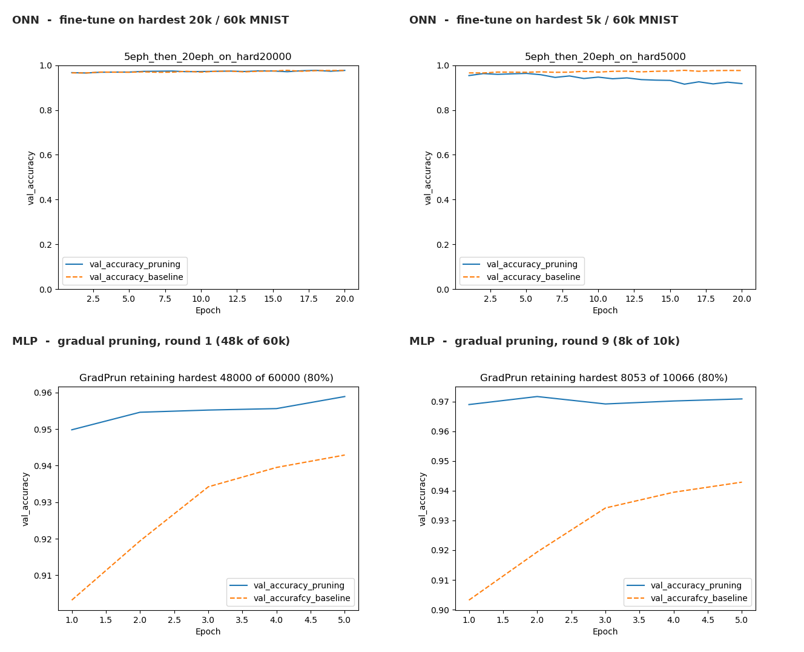
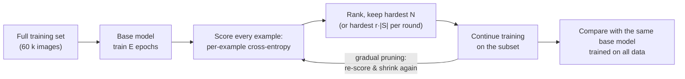

<h1 align="center">Data Pruning for Mesh Optical Neural Networks</h1>

<p align="center">
  <em>How much of MNIST does a photonic Mach–Zehnder mesh actually need?</em><br>
  Loss-based hard-example selection and iterative pruning for maximally error-tolerant Clements-mesh ONNs,
  with a dense MLP as the electronic control.
</p>

<p align="center">
  
  
  
  
</p>

<p align="center">
  
</p>

---

## The question

Optical neural networks built from meshes of Mach–Zehnder interferometers (MZIs) promise fast, low-energy
inference, but **training them is expensive**: every gradient step is a simulation of a 256-mode interferometer
with ~132 k phase parameters, and the *maximally error-tolerant* training recipe of Vadlamani, Englund & Hamerly
has to be repeated across many fabrication-error levels. Anything that shrinks the training set shrinks that cost.

[Sorscher et al. (NeurIPS 2022)](https://arxiv.org/abs/2206.14486) showed that for electronic networks one can beat
power-law scaling by keeping only the *hardest* examples. This project asks whether the same trick survives on
photonic hardware simulators:

> Rank the training set by a lightly-trained model's per-example loss, keep the hardest *N*, and keep training
> only on those. Does a mesh ONN still reach full-data accuracy? And is it safer to prune all at once or gradually?

## Headline results (MNIST, 10-way classification)

| Model | Training data kept | Test accuracy | Same model on all 60 k |
|---|---|---|---|
| 2-layer, 256-mode Clements-mesh ONN (~132 k phases) | hardest **20 k / 60 k** (33 %) | **97.67 %** | ≈ 98 % |
| same ONN | hardest **10 k / 60 k** (17 %) | **97.01 %** | ≈ 98 % |
| MLP 784-165-10, iterative pruning (80 % retention, 10 rounds) | **6.4 k / 60 k** (11 %) | **96.97 %** | ≈ 97 % |

* One-shot pruning to a third of MNIST costs the optical network essentially nothing; the loss ranking of a
  5-epoch model is already a good proxy for "which images matter".
* Pushing one-shot pruning further (≤ 5 k examples) starts to hurt – the hardest few thousand images are a
  biased slice of the data, and fine-tuning on them alone slowly drifts the model away from the full-data solution.
* Pruning **gradually** – shrink by 20 % per round, re-rank with the updated model each round – avoids that
  cliff: the MLP stays at ≈ 97 % down to 6.4 k images. The 30 % / 50 % retention schedules show the failure mode
  once the set collapses to tens of images.

All curves, per-setting, are in [`results/`](results/README.md).

## Method



Two model families share the pipeline:

| | Mesh ONN (`--model onn`) | Dense MLP control (`--model ann`) |
|---|---|---|
| Input | 28×28 image → 2-D FFT → central 16×16 window → 256 complex, power-normalised modes | raw 784 pixels |
| Network | 2 × [256-mode Clements MZI mesh → electro-optic intensity-modulation nonlinearity], then \|·\|², first 10 outputs, L2-normalised | 784 → 165 (ReLU) → 10 (softmax) |
| Parameters | ≈ 2 × (32 640 θ + 32 640 φ + 256 γ) ≈ 132 k | 131 k |
| Simulator | [`neurophox`](https://github.com/solgaardlab/neurophox) with the QPG-MIT beamsplitter-error / waveguide-loss patch | `tf.keras` |

The ONN construction (`const_onn_EO`), Fourier pre-processing (`MNISTDataProcessor`) and the
error-aware training/transfer routines come from the MIT Quantum Photonics Group's
[Maximally-Error-Tolerant-Mesh-ONNs](https://github.com/QPG-MIT/Maximally-Error-Tolerant-Mesh-ONNs) code
(vendored, lightly adapted, in [`mesh_onn/`](mesh_onn)); the pruning experiments and scripts in
[`experiments/`](experiments) are mine.

## Repository layout

```
.
├── experiments/                 # the pruning study (argparse scripts, run from the repo root)
│   ├── common.py                #   data / model factories, loss scoring, ranking, I/O, plotting
│   ├── train_base.py            #   1. base model on the full set  + per-example loss ranking
│   ├── finetune_hardest.py      #   2a. one-shot: continue on the hardest N vs. full-data baseline
│   └── gradual_pruning.py       #   2b. iterative: keep r·|S| each round, re-rank, repeat
├── mesh_onn/                    # mesh-ONN simulation library (QPG-MIT upstream, packaged)
│   ├── helperfunctions.py       #   MNISTDataProcessor, EO nonlinearity, const_onn_EO, error correction
│   ├── mainfunctions.py         #   direct / adiabatic transfer training across error levels, lossy meshes
│   ├── errcorr3mzi_riemann.py   #   Clements decomposition with 2-MZI / 3-MZI beamsplitter errors (numba)
│   └── allcalls.py              #   upstream driver script
├── data/losses_per_example/     # ONN per-example loss scores for MNIST, Fashion-MNIST, CIFAR-10
├── results/                     # 80 validation-accuracy plots from the 2023 runs + README
├── setup/neurophox-mesh-errors.patch   # beamsplitter-error / loss / phase-screen patch for neurophox
├── requirements.txt
└── LICENSE
```

## Installation

The simulator targets **TensorFlow 2 with Keras 2** (`tensorflow < 2.16`); Keras 3 is not supported by
`neurophox`. A fresh environment:

```bash
git clone https://github.com/vishwalization/mesh-onn-data-pruning.git
cd mesh-onn-data-pruning
python -m venv .venv && source .venv/bin/activate        # or conda create -n onn python=3.10
pip install -r requirements.txt
```

The mesh simulator needs a patched `neurophox` (the patch adds per-MZI beamsplitter errors, waveguide loss and
the output-side phase screen that `mesh_onn` relies on):

```bash
git clone https://github.com/solgaardlab/neurophox.git
cd neurophox
git checkout 29a9b03
git apply ../setup/neurophox-mesh-errors.patch
pip install -e .            # also installs torch, which neurophox imports at start-up
cd ..
```

Datasets download automatically through `tf.keras.datasets` (plus `extra-keras-datasets` for KMNIST).
The dense-MLP experiments only need TensorFlow – `neurophox` is imported lazily, so `--model ann` runs
without it.

## Reproducing the experiments

Everything is driven from the repository root with `python -m`:

```bash
# 1. base model + loss ranking (5 epochs on all 60 k)
python -m experiments.train_base --model onn --dataset mnist --epochs 5 --out runs/onn_mnist

# 2a. one-shot: 20 more epochs on the hardest N, against the same model on all data
python -m experiments.finetune_hardest --run runs/onn_mnist --epochs 20 \
    --subset-sizes 1000 2000 3000 4000 5000 10000 20000

# 2b. gradual: keep the hardest 80 % each round for 10 rounds, 5 epochs per round
python -m experiments.train_base --model ann --dataset mnist --epochs 5 --out runs/ann_mnist
python -m experiments.gradual_pruning --run runs/ann_mnist --retention 0.8 --rounds 10 --epochs 5
```

Each run directory collects `config.json`, the base SavedModel, pickled Keras histories, `idx,loss`
rankings, a `*summary*.csv` and the plots. `--dataset` accepts `mnist`, `fashion_mnist`, `kmnist`, `cifar10`;
`--help` lists the geometry options (`--windowhalfwidth`, `--layers`, `--bs-error`, `--hidden`).

The pre-computed ONN loss rankings in `data/losses_per_example/` can be used directly:

```bash
python -m experiments.finetune_hardest --run runs/onn_mnist --epochs 20 \
    --ranking data/losses_per_example/mnist_onn_loss_per_example.csv
```

### Using the mesh library on its own

```python
from mesh_onn import helperfunctions as h

data  = h.MNISTDataProcessor(dataset="mnist").fourier(8)      # 256 complex modes per image
model = h.const_onn_EO(256, L=2, gamma_pos="out", bs_error=0.0)
model.compile(optimizer="adam", loss="categorical_crossentropy", metrics=["accuracy"])
model.fit(data.x_train, data.y_train, epochs=5, batch_size=512,
          validation_data=(data.x_test, data.y_test))
```

`mesh_onn.mainfunctions` adds the error-aware recipes from the upstream paper: `directtraining` (train meshes
at a fixed beamsplitter error), `transfertraining` (walk a trained ideal mesh adiabatically from 0 % to
35 % splitter error), `lossymeshaccuracies` (plug trained phases into lossy meshes) and the Bandyopadhyay-style
`error_correction` / `noisytoideal` phase remapping in `helperfunctions`.

## Context

Work carried out July – December 2023 as a remote research project with the MIT EECS Quantum Photonics Group
(guides: Prof. Dirk Englund and Dr. Sri Krishna Vadlamani), on top of the group's maximally-error-tolerant
mesh-ONN simulator. Notebooks from the study were converted into the scripts in `experiments/`; trained
checkpoints (~220 MB) are not tracked and can be regenerated with the commands above.

## References

* S. K. Vadlamani, D. Englund, R. Hamerly, *Transferable learning on analog hardware*, Science Advances **9** (28),
  eadh3436 (2023). [doi:10.1126/sciadv.adh3436](https://doi.org/10.1126/sciadv.adh3436) ·
  [arXiv:2210.06632](https://arxiv.org/abs/2210.06632) ·
  code: [QPG-MIT/Maximally-Error-Tolerant-Mesh-ONNs](https://github.com/QPG-MIT/Maximally-Error-Tolerant-Mesh-ONNs)
* B. Sorscher, R. Geirhos, S. Shekhar, S. Ganguli, A. S. Morcos, *Beyond neural scaling laws: beating power
  law scaling via data pruning*, NeurIPS 2022. [arXiv:2206.14486](https://arxiv.org/abs/2206.14486)
* W. R. Clements et al., *Optimal design for universal multiport interferometers*, Optica **3**, 1460 (2016).
* S. Pai et al., `neurophox` – [github.com/solgaardlab/neurophox](https://github.com/solgaardlab/neurophox)

## License

MIT. The `mesh_onn/` package is derived from code © 2023 MIT Quantum Photonics Group (MIT License);
everything else © 2023–2024 A.K. Vishwanathan. See [`LICENSE`](LICENSE).
